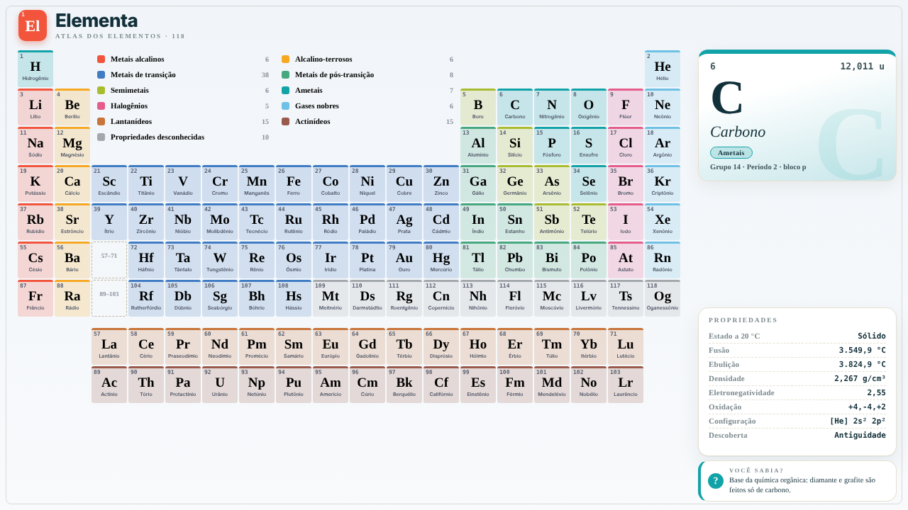
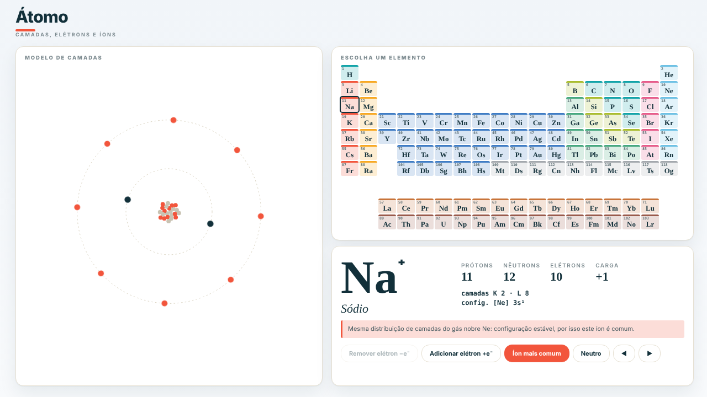
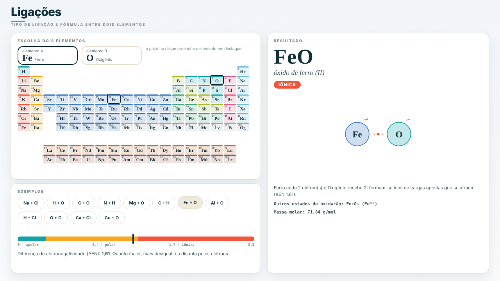
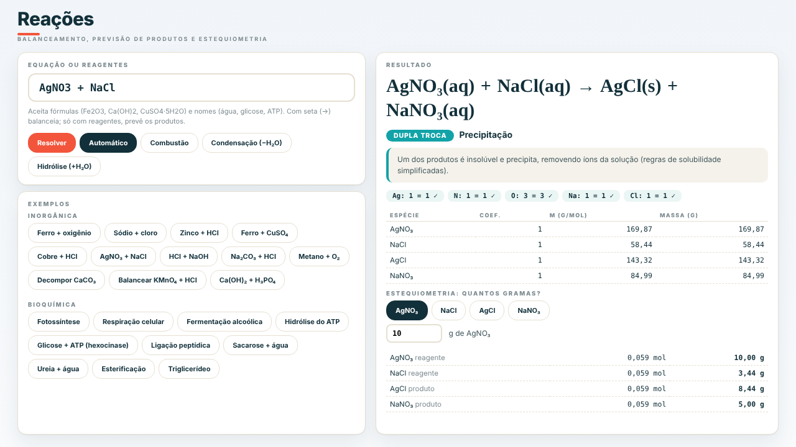
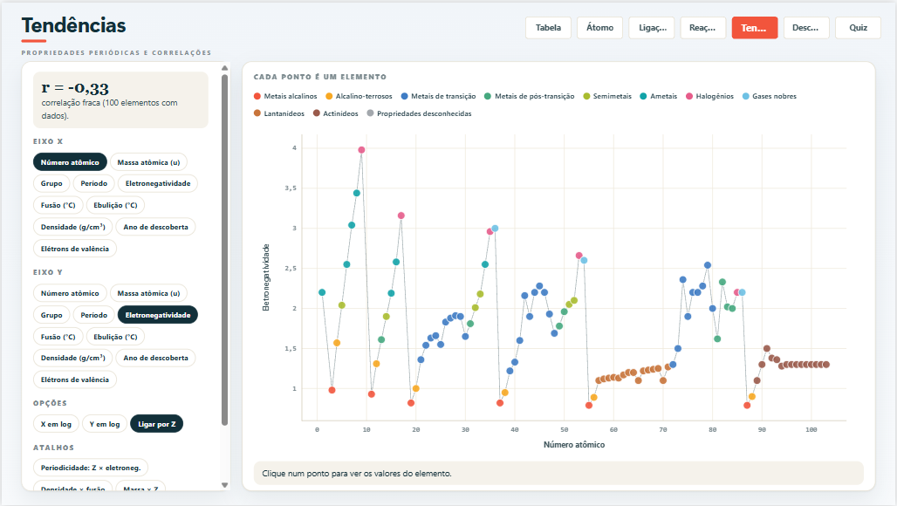
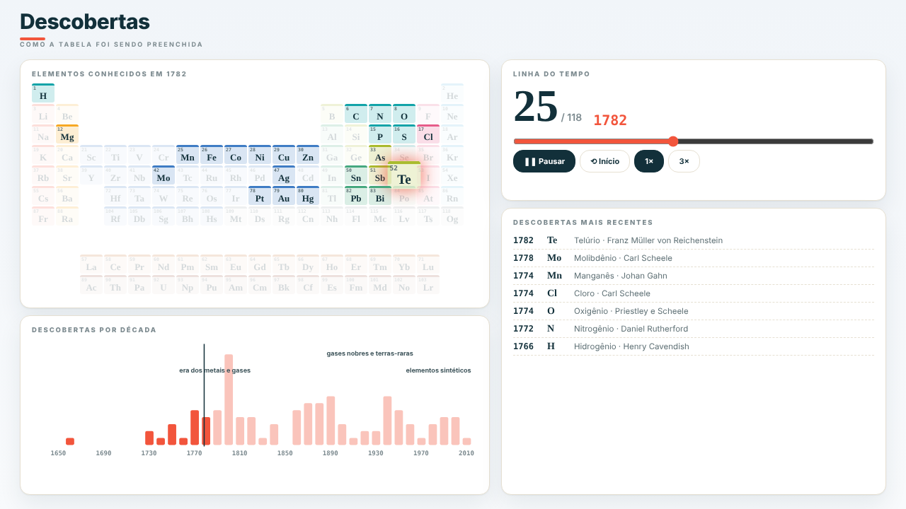
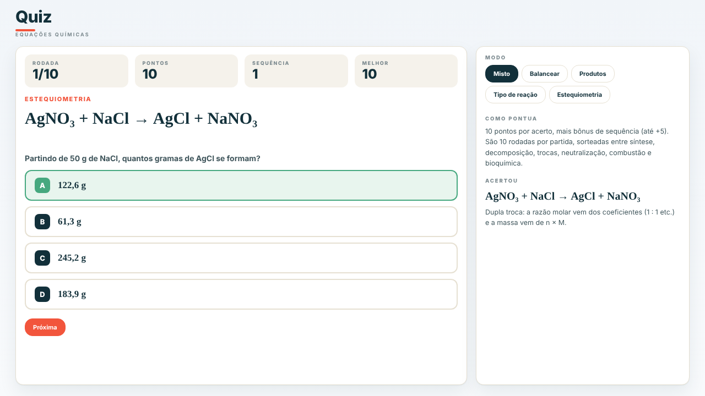

# Elementa

**Uma tabela periódica interativa feita no Power BI com HTML, CSS e JavaScript.**

### [Ver o relatório online](https://app.powerbi.com/view?r=eyJrIjoiMDc1OTIxMTAtYzhmZi00NDgyLTg0MjctZmM2M2EyOTc2NmNmIiwidCI6IjIzNjhkMzViLWZjNDQtNDMyMi1iOGI3LTBjM2ViNzhhMGRhYyJ9)



## Sobre o projeto

O Elementa é um estudo sobre até onde dá para levar o Power BI quando ele trabalha junto com HTML.

Os visuais nativos do Power BI são ótimos para gráficos e tabelas, mas têm limites de layout e de interação. A ideia aqui foi testar outro caminho: usar o visual **HTML Content** e deixar que medidas DAX montem a tela em HTML, CSS e SVG. Nas páginas mais interativas, a medida entrega um pequeno app em JavaScript que roda dentro do relatório.

Para ter um assunto que exigisse bastante do visual, escolhi a química: a tabela periódica, o modelo do átomo, ligações, reações e um quiz.

## O que eu quis aprender

- **DAX gerando HTML:** usar medidas para montar texto HTML a partir dos dados e da seleção do usuário.
- **Interação sem relacionamentos:** usar tabelas desconectadas para que o clique numa célula ou na legenda mude o que as outras medidas mostram.
- **CSS no Power BI:** criar um visual próprio (cards, cores por categoria, tipografia) sem depender do tema padrão.
- **JavaScript dentro do relatório:** colocar páginas inteiras em JS, com os dados vindos de uma medida DAX.
- **Projeto como código:** usar o formato PBIP (PBIR + TMDL) para que o relatório fique em arquivos de texto, versionados no Git e gerados por scripts Python.

## Páginas

| Página | O que dá para fazer | Como foi feita |
|--------|---------------------|----------------|
| **Tabela** | Clicar em um elemento e ver ficha, átomo, propriedades e curiosidade. Colorir por categoria, estado, eletronegatividade, densidade, fusão ou ano de descoberta. | DAX + HTML/CSS/SVG |
| **Átomo** | Ver as camadas de elétrons animadas e formar íons tirando ou colocando elétrons. | JavaScript + SVG |
| **Ligações** | Escolher dois elementos e ver o tipo de ligação, a fórmula e a massa molar. | JavaScript + SVG |
| **Reações** | Digitar uma equação para balancear, ou só os reagentes para prever os produtos. Calcula a estequiometria em gramas. | JavaScript |
| **Tendências** | Comparar duas propriedades num gráfico de dispersão, com correlação. | JavaScript + SVG |
| **Descobertas** | Ver a tabela sendo preenchida conforme os elementos foram descobertos. | JavaScript |
| **Quiz** | Treinar balanceamento, produtos, tipo de reação e estequiometria. | JavaScript |

<p>
  
  
  
  
  
  
</p>

## Como funciona

1. Os dados dos 118 elementos ficam dentro da consulta Power Query. O relatório não depende de internet nem de API.
2. Medidas DAX leem a seleção do usuário e montam o HTML de cada parte da tela.
3. O CSS de cada visual também é uma medida, ligada ao campo de estilo do HTML Content.
4. Nas páginas em JavaScript, uma medida transforma a tabela de elementos em um objeto JS. Outra medida entrega o código da página, que desenha tudo e responde aos cliques.

O motor de química (`quimica.js`) lê fórmulas com parênteses e hidratos e balanceia equações por eliminação de Gauss com frações exatas. Ele prevê produtos para as reações estudadas no ensino médio: síntese, decomposição, simples troca, dupla troca, neutralização, combustão, condensação e hidrólise. Não é um simulador geral e avisa quando não reconhece os reagentes.

## Estrutura

| Pasta | Conteúdo |
|-------|----------|
| `Elementa.SemanticModel/` | Modelo de dados (TMDL), gerado pelo `build_modelo.py` |
| `Elementa.Report/` | Relatório (PBIR), gerado pelo `build_relatorio.py` |
| `src/dados/` | Dados dos elementos (`gerar_dados.py` e `elementos.psv`) |
| `src/m/` | Consultas Power Query |
| `src/dax/` | Medidas DAX |
| `src/css/` | Estilos da página Tabela |
| `src/js/` | Páginas em JavaScript e seus estilos |
| `src/testes/` | Testes do motor de química e das páginas JS |
| `docs/` | Imagens das páginas |

## Rodando no seu computador

1. Instale o Power BI Desktop e ative os recursos em versão prévia de **PBIP**, **TMDL** e **PBIR**.
2. Abra o arquivo `Elementa.pbip`.
3. Clique em **Atualizar**.

## Alterando o projeto

O código-fonte fica em `src/`. Depois de editar, feche o Power BI Desktop e rode:

```
python src/dados/gerar_dados.py
python src/build_modelo.py
python src/build_relatorio.py
```

O primeiro comando só é necessário quando os dados dos elementos mudam.

Como o JavaScript vira texto dentro de uma medida DAX, ele **não pode ter aspas duplas nem crases**. Dentro do HTML escrito no JS, use `~` no lugar das aspas simples.

Para testar:

```
node src/testes/testar_quimica.js
npm install puppeteer
node src/testes/testar_js.js
```

## Observações

- Os valores das propriedades são de referência, para estudo. Elementos sintéticos mais recentes (104 em diante) não têm todas as propriedades medidas.
- As fórmulas da página Ligações seguem a regra do octeto e os estados de oxidação mais comuns, então são uma previsão simplificada.
